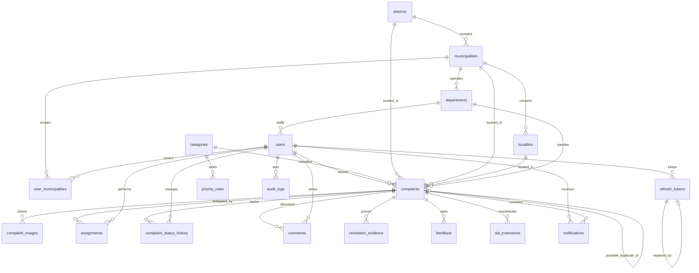
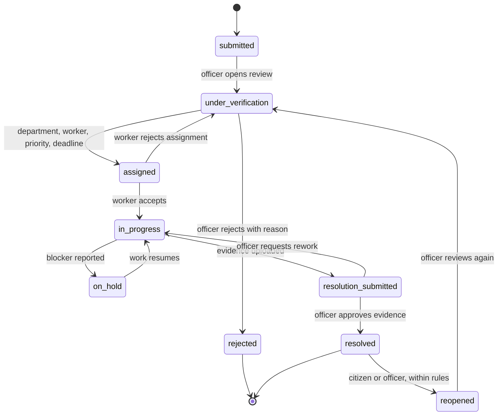
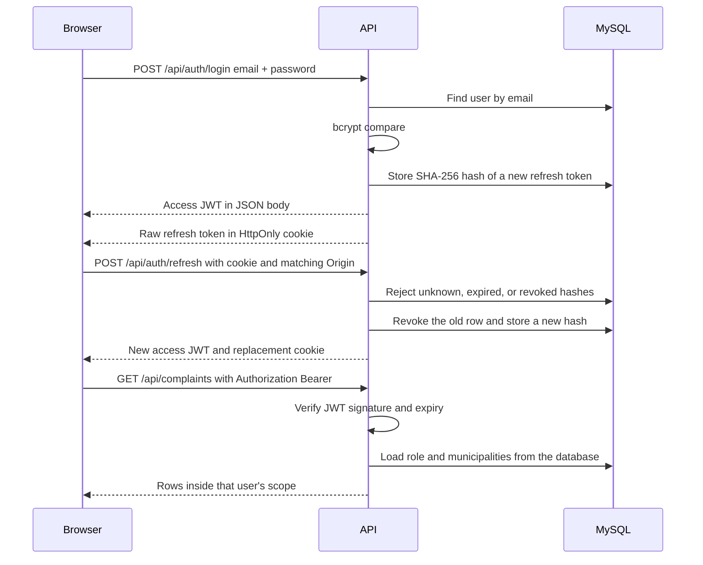

# Nagara — Project Plan

**Product:** Nagara  
**Tagline:** Better streets. Better communities.  
**Status:** Phase 0 complete. Application code has not been written.  
**Waiting for:** approval of this plan before Phase 1.

Nagara is an independent academic prototype for a Software Engineering and Software Design project. It is not an official Government of Telangana product and does not connect to any government system.

---

## 1. Workspace inspection

Environment confirmed on 8 November 2026. These tools are already installed and are the ones this project will use.

| Check | Result |
| --- | --- |
| Project folder | `C:\Users\acer\nagara` |
| Workspace root | `C:\Users\acer\nagara` |
| Files in the folder | `PROJECT_PLAN.md` and `README.md` only |
| Application code | None |
| Node.js | v24.21.0, installed |
| npm | 11.19.0, installed |
| Git | Git for Windows, installed |
| MySQL Server | 8.0.46, installed |
| MySQL Workbench | Installed. The connection has been tested successfully. |
| Database | `nagara` already exists |
| Application database user | `nagara_user` |
| Database access | `nagara_user` has connected and executed SQL against `nagara` |

Phase 0 maintains only this file and `README.md`. Frontend, backend, schema, and seed code stay unwritten until you approve the plan.

---

## 2. Product in one paragraph

Citizens report infrastructure problems with photos and a map location. Municipal officers, limited to their own municipalities, verify those reports, set priority and a deadline, and assign a field worker. Field workers accept the task, post progress, and upload completion photos. An officer reviews that evidence before the complaint can become resolved. Citizens then leave feedback, or reopen the issue when the rules allow it. Every status change is stored in history.

There are exactly three roles: `citizen`, `officer`, and `worker`. There is no global administrator role.

---

## 3. Decisions to approve before coding

These choices keep the approved stack (React, Vite, Tailwind, Express, MySQL, JWT, Cloudinary) and change only how the pieces are organized.

1. **SQL stays visible.** The backend uses `mysql2` and a repository file per table group. There is no ORM. You can read the queries, and every query uses placeholders (`?`) so user input is never concatenated into SQL.

2. **One shared contract.** A small `shared/` folder holds role names, status names, priorities, and API error codes used by both client and server. That stops the UI and the API from drifting apart.

3. **Jurisdiction is a table, not a hardcoded city.** Officers and field workers are linked to one or more municipalities through `user_municipalities`. A query for “my complaints” always filters by those municipalities. A user with no municipality link sees no operational records. Citizens may report in any seeded Telangana municipality.

4. **Departments belong to a municipality.** “Roads” in one municipality is a different row from “Roads” in another.

5. **Overdue is a condition, not a replacement status.** A complaint that is still `in_progress` after its deadline stays `in_progress` and gets `is_overdue = true`. The UI shows an Overdue badge beside the real status. The first time that flag flips, one `audit_logs` row records the event. Status history is left unchanged, because the workflow status did not change. Later checks of the same overdue episode do not write another row.

6. **Two early statuses are both real.** `submitted` means the citizen has filed it. `under_verification` means an officer has opened it for review. The officer chooses verify-and-assign, or reject with a reason.

7. **Workers cannot resolve their own work.** A worker’s final action sets `resolution_submitted`. Only an officer in that municipality can set `resolved`, or send the complaint back to `in_progress`.

8. **Login uses two tokens.** The access token is a short-lived JWT kept in memory. The refresh token is a random value stored only as a hash in `refresh_tokens`, and the browser receives it in an HttpOnly cookie. Refresh rotates that token. Logout revokes it. Passwords are stored only as bcrypt hashes.

9. **Photos go through one storage service.** Cloudinary and a private local directory are interchangeable drivers behind the same functions. Uploads are checked by their real image bytes, limited to 5 MB and 4 files, and saved under a random key. Private images are served only after an authorization check. The README will say which driver is active.

10. **Duplicate detection only flags.** Same category, same municipality, within a configurable radius (default 200 metres) and a configurable age (default 14 days), plus a simple word-overlap score on the title and description. Officers see “possible duplicate.” The system does not auto-reject.

11. **Priority is rule-based.** Category, a public-safety flag, an optional affected-people count, and age since submission pick a suggested priority from `priority_rules`. An officer may override it and must give a reason. The UI will call this a rules engine, not AI.

12. **Public map hides identity.** Public endpoints return category, status, municipality, and a summary. They omit name, email, phone, and exact coordinates. Public latitude and longitude are rounded to about 110 metres.

Items 5, 8, and 9 now include the session, overdue-audit, and photo rules from this revision. The whole plan is still waiting for approval before Phase 1.

---

## 4. Folder structure

```text
nagara/
  client/                     React + Vite app
    index.html                Theme script runs before first paint
    src/
      assets/
      components/             Buttons, inputs, cards, tables, modals, toasts
      layouts/                Public layout, dashboard shell, sidebar
      pages/                  One folder per area: public, citizen, officer, worker
      features/               Complaint, map, analytics, notifications
      hooks/
      contexts/               Auth context, theme context
      services/               Axios client and API modules
      utils/
      styles/                 tokens.css and global Tailwind layers
      routes/                 Route table and role guards
  server/
    src/
      config/                 env, database pool, cloudinary
      controllers/
      middleware/             auth, role, jurisdiction, origin, errors, upload
      routes/
      services/               Workflow, SLA, duplicates, notifications
      repositories/           Parameterized SQL
      validators/
      utils/
      scripts/seed.js         Builds bcrypt hashes, then loads demo data
    storage/private/          Local photo driver. Outside any static folder. Git-ignored.
  database/
    schema.sql
    seed.sql                  Geography, categories, rules. Users via seed.js.
  shared/
    constants.js              Roles, statuses, priorities
  docs/
    api.md                    Filled in during Phase 8
  .env.example                Created in Phase 1, never real secrets
  .gitignore
  README.md
  PROJECT_PLAN.md
```

`shared/` is the only structural addition to the layout in the brief. It exists so status names are defined once.

---

## 5. Database design

MySQL 8, InnoDB, `utf8mb4`. Primary keys are `BIGINT` auto-increment. Timestamps are `created_at` and `updated_at` where rows change. Passwords are `password_hash` only.

### Entity relationships



### Tables

**districts** — `id`, `name`, `code` unique.

**municipalities** — `id`, `district_id`, `name`, `code` unique. This is the jurisdiction boundary.

**localities** — `id`, `municipality_id`, `name`.

**departments** — `id`, `municipality_id`, `name`, `description`, `is_active`. Unique `(municipality_id, name)`.

**users** — `id`, `full_name`, `email` unique, `phone`, `password_hash`, `role` (`citizen` | `officer` | `worker`), `department_id` nullable, `is_active`, timestamps. Officers and workers also need at least one `user_municipalities` row before they can see operational data. A citizen’s preferred district and municipality live on the profile as nullable foreign keys (`home_district_id`, `home_municipality_id`) and do not grant access to other people’s complaints.

**user_municipalities** — `user_id`, `municipality_id`, primary key on both columns. Used only for officers and workers.

**refresh_tokens** — `id`, `user_id`, `token_hash` unique, `expires_at`, `revoked_at` nullable, `replaced_by_id` nullable, `created_at`. The raw refresh token is never stored. `token_hash` is the SHA-256 hash of that random value. `replaced_by_id` points at the new row created when this token is rotated. Logout sets `revoked_at` and leaves `replaced_by_id` empty.

**categories** — `id`, `name`, `slug` unique, `description`, `icon_key`, `is_active`. Extra categories are new rows, not code changes. Seeded rows:

| Category | Icon direction |
| --- | --- |
| Roads and Potholes | road |
| Water Supply and Leakage | droplet |
| Streetlights and Electricity | lamp |
| Garbage and Sanitation | trash |
| Public Property Damage | building |
| Public Safety and Hazards | shield |

**complaints** — `id`, `reference_code` unique (example `NGR-HYD-00042`), `citizen_id`, `category_id`, `district_id`, `municipality_id`, `locality_id`, `department_id` nullable, `title`, `description`, `latitude`, `longitude`, `status`, `priority`, `priority_source` (`rule` or `officer`), `priority_reason`, `people_affected` nullable, `safety_risk`, `deadline_at` nullable, `is_overdue`, `duplicate_of_id` nullable, `duplicate_score` nullable, `rejection_reason` nullable, `reopen_count`, `submitted_at`, `verified_at`, `resolved_at`, timestamps.

**complaint_images** — citizen photos at filing time. `complaint_id`, `storage_key`, `url`, `uploaded_by`, `created_at`.

**assignments** — one row per assignment attempt. `complaint_id`, `worker_id`, `officer_id`, `status` (`pending`, `accepted`, `rejected`, `completed`), `rejection_reason`, `assigned_at`, `responded_at`. Reassignment inserts a new row. The current assignment is the latest row that is `pending` or `accepted`.

**complaint_status_history** — `complaint_id`, `from_status`, `to_status`, `changed_by`, `note`, `created_at`. Insert only. No updates.

**comments** — `complaint_id`, `user_id`, `body`, `visibility` (`public` or `internal`). Internal notes stay off the citizen and public pages.

**resolution_evidence** — worker photos and notes. `complaint_id`, `assignment_id`, `uploaded_by`, `kind` (`before`, `after`, `progress`, `blocker`), `storage_key`, `url`, `note`, `review_status` (`pending`, `approved`, `rework`), `created_at`.

**feedback** — `complaint_id`, `citizen_id`, `rating` 1–5, `comment`, `cycle` (increments when a complaint is reopened and resolved again). Unique `(complaint_id, cycle)`.

**notifications** — `user_id`, `type`, `title`, `body`, `complaint_id` nullable, `is_read`, `created_at`. In-app only for this project.

**priority_rules** — `category_id` nullable, `safety_risk` nullable, `min_people_affected` nullable, `min_age_hours` nullable, `priority`, `sla_hours`, `is_active`. The most specific matching active rule wins. Seeded defaults live in the database, not as scattered numbers in controllers.

**sla_extensions** — `complaint_id`, `previous_deadline`, `new_deadline`, `reason`, `extended_by`, `created_at`.

**audit_logs** — `user_id` nullable, `action`, `entity_type`, `entity_id`, `metadata` JSON, `ip_address`, `created_at`. Used for verification, rejection, assignment, priority override, resolution, reopen, and the first moment a complaint becomes overdue. A system overdue event uses a null `user_id` and the action `complaint.overdue`.

### Indexes

- `users.email`
- `refresh_tokens.token_hash` unique
- `refresh_tokens (user_id, revoked_at)`
- `complaints (municipality_id, status, created_at)`
- `complaints (citizen_id, created_at)`
- `complaints (category_id, municipality_id, created_at)` for duplicate search
- `complaints.reference_code`
- `assignments (worker_id, status)`
- `notifications (user_id, is_read, created_at)`
- `complaint_status_history (complaint_id, created_at)`

Nearby-complaint search uses latitude and longitude with a bounding box, then a haversine distance in SQL. Coordinates are `DECIMAL(10,7)`. A spatial `POINT` column can be added later if the demo data grows large. It is unnecessary for the seed size.

### Transactions

These operations commit or roll back as one unit:

- Create complaint, images, first history row, and citizen confirmation notification.
- Verify and assign: complaint update, assignment row, history, worker notification.
- Worker completion: evidence rows, status change, history, officer notification.
- Officer resolve or rework.
- Citizen reopen.
- Refresh-token rotation: insert the new hash, then set `revoked_at` and `replaced_by_id` on the previous row.

### Demo data

Fictional people only. Real Telangana district and municipality names are used as the geographic scope, labeled as demo seed.

Planned coverage: Hyderabad, Rangareddy, Medchal–Malkajgiri, Hanamkonda, Karimnagar, Nizamabad, Khammam, and Nalgonda, with a few municipalities and localities under each. About twenty complaints spread across the lifecycle so dashboards are populated from queries.

Demo password for every seed account: `NagaraDemo#2026`. `seed.js` hashes it with bcrypt. The hash is what MySQL stores.

| Role | Email | Scope |
| --- | --- | --- |
| Citizen | `ananya.rao@nagara.demo` | Reports in Greater Hyderabad |
| Citizen | `karthik.reddy@nagara.demo` | Reports in Warangal |
| Officer | `meera.nair@nagara.demo` | Greater Hyderabad only |
| Officer | `imran.shaik@nagara.demo` | Greater Warangal only |
| Worker | `ravi.kumar@nagara.demo` | GHMC Roads |
| Worker | `lakshmi.devi@nagara.demo` | GHMC Water |
| Worker | `suresh.goud@nagara.demo` | Warangal Sanitation |

---

## 6. Complaint lifecycle



Allowed actors:

| From | To | Who |
| --- | --- | --- |
| — | submitted | Citizen who owns the new complaint |
| submitted | under_verification | Officer in that municipality |
| under_verification | rejected | Officer in that municipality, reason required |
| under_verification | assigned | Officer in that municipality |
| assigned | under_verification | Assigned worker rejects, reason required |
| assigned | in_progress | Assigned worker accepts |
| in_progress | on_hold | Assigned worker or officer, note required |
| on_hold | in_progress | Assigned worker or officer |
| in_progress | resolution_submitted | Assigned worker, at least one after-photo |
| resolution_submitted | resolved | Officer in that municipality |
| resolution_submitted | in_progress | Officer, rework note required |
| resolved | reopened | Reporting citizen, or officer in jurisdiction |
| reopened | under_verification | Officer in that municipality |

Reopen rules, stored in config so they are easy to change:

- Status must be `resolved`.
- A reason is required.
- Citizen reopen window is 7 days after `resolved_at`.
- Maximum 2 reopens per complaint.
- `reopen_count` increments and a history row is written.
- Feedback for the previous cycle is kept.

SLA defaults, also stored in `priority_rules` and adjustable per category:

| Priority | Default resolution window |
| --- | --- |
| Critical | 24 hours |
| High | 72 hours |
| Medium | 7 days |
| Low | 14 days |

The deadline is set when the complaint becomes `assigned`. An extension inserts an `sla_extensions` row and updates `deadline_at`. If the new deadline is still in the future, `is_overdue` is cleared.

A scheduled check, plus a check whenever complaints are listed, marks a complaint overdue when `deadline_at` has passed and the status is still `assigned`, `in_progress`, `on_hold`, or `resolution_submitted`.

That check writes one `audit_logs` row, action `complaint.overdue`, only when `is_overdue` changes from false to true. The workflow status stays whatever it already was, so `complaint_status_history` gets no row for this event. Repeating the check while `is_overdue` is already true does not write another audit row. If a deadline extension clears the flag and the complaint later passes the new deadline, that later change is a new event and gets one new audit row.

Suggested priority before the officer confirms it:

- Public safety category or `safety_risk` starts at high, or critical when people-affected is 50 or more.
- Water and roads start at medium.
- Garbage, property damage, and streetlights start at low unless safety risk is set.
- Age past half of the current SLA suggests one step upward. The officer still confirms the value.

### Assignment rules

Assignment is allowed only through the backend. The officer screen can hide invalid choices, and the API still checks all of the following before it inserts an `assignments` row:

- The signed-in user is an active officer.
- That officer has a `user_municipalities` row for the complaint’s `municipality_id`.
- The complaint status allows assignment.
- The selected department belongs to that same municipality.
- The selected user is an active worker.
- That worker has a `user_municipalities` row for the complaint’s municipality.
- The worker’s `department_id` is the selected department.

An officer may assign any department inside their own municipality. A worker from another department, or a department that belongs to another municipality, is rejected. The same municipality check blocks assignment of a complaint outside the officer’s jurisdiction.

---

## 7. Authentication and authorization



- Registration creates a `citizen` only. Officers and workers come from seed data or from an officer creating a worker inside their own municipality.
- Access token lifetime: 2 hours. It is a JWT kept in memory and sent as `Authorization: Bearer`.
- Refresh token lifetime: 7 days. It is 32 random bytes, encoded for the cookie. MySQL stores only the SHA-256 hash in `refresh_tokens.token_hash`.

### Refresh cookie

| Setting | Value |
| --- | --- |
| Name | `nagara_refresh` |
| HttpOnly | Yes, so page scripts cannot read it |
| Secure | Yes when `NODE_ENV=production`. Left off for local `http://localhost` so the browser will store it during development |
| SameSite | `Lax`. The client and API are same-site across ports on localhost, and this blocks cross-site form posts |
| Path | `/api/auth`, so the browser sends it only to login, refresh, and logout |

`POST /api/auth/refresh` and `POST /api/auth/logout` also require an `Origin` header that exactly matches `CLIENT_ORIGIN`. If `Origin` is absent, a `Referer` from that same origin is accepted. Any other origin, or a missing origin and referer, is rejected before the token is looked up. That check is the CSRF control for the two cookie-authenticated posts. Other API calls use the Bearer access token, which a third-party page cannot attach.

### Rotation, logout, and rejection

Refresh runs in one transaction:

1. Hash the cookie value and load that `refresh_tokens` row.
2. Reject the request when no row exists.
3. Reject the request when `expires_at` is in the past. The expired row is not rotated and cannot start a new session.
4. If `revoked_at` is set and `replaced_by_id` points at a newer token, treat the cookie as a reused refresh token. Revoke every still-active refresh token for that user, then reject the request.
5. If `revoked_at` is set because of logout, reject the request. Logout leaves `replaced_by_id` empty, so this does not revoke the user’s other sessions.
6. Otherwise insert a new hash, set the old row’s `revoked_at` to the current time, and set its `replaced_by_id` to the new row. The response sets a new access JWT and replaces the cookie.

Logout checks the origin, hashes the cookie, sets `revoked_at` on that active row, and clears the cookie with the same path and flags. It does not set `replaced_by_id`. A second logout of an already revoked token still clears the cookie and does not create a new session.

A deactivated user is rejected on login, refresh, and access-token checks.

- `authenticate` reads the Bearer token and loads the user from MySQL.
- `authorize('officer')` checks the database role. The client cannot send a role and have it trusted.
- `requireMunicipality(complaint)` checks that an officer or worker is linked to that complaint’s municipality. Citizens can read and comment on their own complaints only.
- Assignment uses the rules in section 6, in the workflow service, on the server.
- Public routes (`/api/public/...`) return the anonymized shape only.
- Passwords: minimum 8 characters, one letter, and one number. bcrypt cost factor 12.
- Helmet, CORS locked to the client origin, and a JSON body size limit are part of the server setup.

### Photo storage

Both drivers implement the same storage service: save, open, and delete. `STORAGE_DRIVER=cloudinary` or `STORAGE_DRIVER=local` selects the driver. Callers pass bytes and receive a random storage key. They do not choose Cloudinary or disk paths themselves.

Upload rules, enforced on the server:

- Accept JPEG, PNG, and WebP only after reading the file bytes. A renamed extension or a claimed MIME type is not enough.
- Reject a file larger than 5 MB.
- Reject a request with more than 4 files.
- Build the storage key with a random id. Ignore the original filename when choosing the path or Cloudinary public id.

Local files are written under `server/storage/private/`. That directory is not served by `express.static`, and it is not placed in `client/public`. The API reads a file only after the same authorization check used to view that complaint: the reporting citizen, an officer linked to the complaint’s municipality, or the worker on the current assignment.

Cloudinary assets use the same random key and are stored as private assets. The API returns a short-lived signed URL, or streams the file, only after that same authorization check. Public complaint responses omit complaint photos and resolution evidence.

Image and evidence routes:

| Route | Who |
| --- | --- |
| `POST /complaints/:id/images` | Reporting citizen, at filing time, within the size and count limits |
| `GET /complaints/:id/images/:imageId` | Citizen owner, jurisdiction officer, or assigned worker |
| `POST /complaints/:id/evidence` | Assigned worker |
| `GET /complaints/:id/evidence/:evidenceId` | Citizen owner, jurisdiction officer, or assigned worker |

---

## 8. API structure

Base path: `/api`. JSON shape:

```json
{ "success": true, "data": {}, "meta": { "page": 1, "pageSize": 20, "total": 0 } }
```

```json
{ "success": false, "error": { "code": "VALIDATION_ERROR", "message": "...", "details": [] } }
```

| Group | Main routes | Access |
| --- | --- | --- |
| Auth | `POST /auth/register`, `/auth/login`, `/auth/refresh`, `/auth/logout` | Public, except logout |
| Profile | `GET/PATCH /users/me`, `PATCH /users/me/password` | Signed-in user |
| Geography | `GET /districts`, `/municipalities`, `/localities` | Public read |
| Departments | `GET/POST/PATCH /departments` | Officer, own municipalities |
| Categories | `GET /categories` | Public read |
| Complaints | `POST /complaints`, `GET /complaints`, `GET /complaints/:id` | Role and scope filters |
| Workflow | `POST /complaints/:id/verify`, `/reject`, `/assign`, `/accept`, `/decline`, `/progress`, `/complete`, `/approve`, `/rework`, `/reopen`, `/hold` | As in the lifecycle table |
| Images | `POST /complaints/:id/images`, `GET /complaints/:id/images/:imageId` | Upload by the reporting citizen. Download only after the complaint authorization check |
| Comments | `GET/POST /complaints/:id/comments` | Participants. Internal comments stay off citizen responses |
| Evidence | `POST /complaints/:id/evidence`, `GET /complaints/:id/evidence/:evidenceId` | Upload by the assigned worker. Download only after the complaint authorization check |
| Feedback | `POST /complaints/:id/feedback` | Owning citizen, after resolved |
| History | `GET /complaints/:id/history` | Participants and jurisdiction officers |
| Workers | `GET/POST /workers`, `PATCH /workers/:id` | Officer, same municipality |
| Notifications | `GET /notifications`, `POST /notifications/:id/read`, `POST /notifications/read-all` | Owner only |
| Analytics | `GET /analytics/summary`, `/trends`, `/departments`, `/sla` | Officer, own municipalities |
| Public map | `GET /public/complaints`, `GET /public/complaints/:id` | Anonymous, redacted |

List endpoints accept `page`, `pageSize` (max 50), `sort`, `order`, and filters for district, municipality, locality, category, department, priority, status, and overdue.

Status changes go through one workflow service. Controllers do not update `complaints.status` on their own.

---

## 9. Frontend

### Routes

| Path | Who |
| --- | --- |
| `/` | Landing |
| `/about` | About |
| `/how-it-works` | How it works |
| `/issues` | Public map |
| `/issues/:id` | Public complaint, redacted |
| `/login`, `/register` | Auth |
| `/citizen` | Citizen dashboard |
| `/citizen/complaints/new` | Report an issue |
| `/citizen/complaints` | My complaints |
| `/citizen/complaints/:id` | Tracking, comments, feedback, reopen |
| `/citizen/notifications`, `/citizen/profile` | Citizen |
| `/officer` | Officer dashboard |
| `/officer/complaints` | Queue with filters |
| `/officer/complaints/:id` | Verify, assign, review evidence |
| `/officer/workers`, `/officer/departments` | Management inside jurisdiction |
| `/officer/sla`, `/officer/analytics` | Monitoring |
| `/officer/notifications`, `/officer/profile` | Officer |
| `/worker` | Worker dashboard |
| `/worker/tasks`, `/worker/tasks/:id` | Assignments, map, progress, evidence |
| `/worker/history` | Completed work |
| `/worker/notifications`, `/worker/profile` | Worker |
| `*` | Not found |

Verification and assignment are sections of the officer complaint page, with their own actions, so those screens exist as real work rather than empty extra pages.

A route guard reads the signed-in role and redirects citizens, officers, and workers to their own home. The API still enforces the same rules.

### Design system

Tokens live in `client/src/styles/tokens.css` and are mapped into Tailwind. Components use token names.

| Token | Light | Dark |
| --- | --- | --- |
| Page | `#F7FAF9` | `#172B2A` |
| Surface | `#FFFFFF` | `#263B3A` |
| Text | `#263B3A` | `#F7FAF9` |
| Primary action | `#075B57` | `#159D91` |
| Secondary action | `#159D91` | `#159D91` |
| Accent | `#8ADBD0` | `#8ADBD0` |
| Muted text | teal-gray with contrast checked against the surface | lighter teal-gray |
| Border | cool gray | low-contrast teal border that still separates surfaces |

Extra neutral shades are allowed for disabled controls, chart series, and borders. The teal identity stays fixed.

Theme behavior:

- `index.html` sets the theme before React loads, using `localStorage` key `nagara-theme`.
- First visit with no saved choice follows the operating system.
- A visible toggle sits in public navigation and in the dashboard top bar.
- Chart.js reads the same CSS variables when the theme changes.
- Leaflet popups and controls get a small theme stylesheet so the map chrome matches.

Typography: Inter from a font source, with a system sans-serif fallback. One type scale for headings, body, labels, buttons, and tables.

Reusable pieces built in Phase 1: button, text field, select, textarea, card, stat, badge, data table, pagination, modal, toast, empty state, sidebar, and top bar. Dashboard pages consume them. They do not invent a second visual style.

Landing page sections: navigation, hero with “Report an Issue” and “Explore Public Issues,” workflow, categories, how it works, impact figures sourced from the API once it exists, map preview, accountability, footer. Until the API exists, Phase 1 may show clearly labeled sample layout content. Those numbers are replaced by query results in Phase 3 and must not remain disguised as live data.

---

## 10. How later features plug in

| Feature | Where it lives | When |
| --- | --- | --- |
| Map picker and markers | `features/map`, React Leaflet, OpenStreetMap tiles | Phase 5 |
| Duplicate flags | `services/duplicates.js` during complaint create | Phase 6 |
| Priority and SLA | `priority_rules`, workflow service | Phase 6, with columns created in Phase 2 |
| Analytics | officer analytics routes and Chart.js | Phase 6 |
| Notifications | written inside the same transactions as status changes | Phase 6, table created in Phase 2 |
| Public redaction | public repository with its own SELECT list | Phase 5 |

Phase 2 creates the full schema, including tables whose screens arrive later, so we do not migrate the demo database in every phase.

---

## 11. Environment and secrets

Git for Windows, Node.js, npm, MySQL Server 8.0.46, and MySQL Workbench are already installed. The `nagara` database exists. `nagara_user` can already connect and run SQL. Nothing here asks for those tools to be installed again.

Nothing secret is written into the repository. The database password stays in `.env`, which is created later from `.env.example` and is not committed.

```text
PORT=4000
CLIENT_ORIGIN=http://localhost:5173
DB_HOST=127.0.0.1
DB_PORT=3306
DB_USER=nagara_user
DB_PASSWORD=
DB_NAME=nagara
JWT_ACCESS_SECRET=
JWT_REFRESH_SECRET=
JWT_ACCESS_EXPIRES=2h
JWT_REFRESH_EXPIRES=7d
CLOUDINARY_CLOUD_NAME=
CLOUDINARY_API_KEY=
CLOUDINARY_API_SECRET=
STORAGE_DRIVER=cloudinary
```

Use a long random string for each JWT secret. For an offline demo, leave the Cloudinary values blank and set `STORAGE_DRIVER=local`. A Cloudinary account is optional and is only needed when the Cloudinary driver is selected.

Postman is for API checks in Phase 2. Cursor is the editor. No Postman collection is required to run the app.

---

## 12. Phase checklist

| Phase | Work | Status |
| --- | --- | --- |
| 0 | Inspect workspace, architecture, ER diagram, this plan, README | Complete, waiting for approval |
| 1 | Vite client, Express skeleton, Tailwind tokens, light/dark theme, shared UI, landing page | Not started |
| 2 | Schema, seed, auth middleware, validation, error format, repositories | Not started |
| 3 | Register, login, logout, role redirects, three dashboards fed by the API | Not started |
| 4 | Full complaint workflow from report to feedback | Not started |
| 5 | Leaflet maps, coordinates, public issue map | Not started |
| 6 | Duplicates, priority, SLA, analytics, notifications, reopen rules | Not started |
| 7 | Role, validation, upload, theme, and empty-state testing | Not started |
| 8 | README, API docs, diagrams, demo script | Not started |

This file is updated at the end of each phase.

---

## 13. Phase 1 preview, after approval

Phase 1 will:

- Initialize the git repository. Git for Windows is already installed.
- Add `.gitignore` and `.env.example`.
- Scaffold `client` with Vite, React, Tailwind, React Router, and the design tokens.
- Scaffold `server` with Express, a health route, and the shared error shape.
- Build the landing, about, how-it-works, login, and register pages as designed screens. Login will not succeed until Phase 3.
- Add the theme toggle and check light and dark on those pages.

Phase 1 will not connect MySQL, accept real logins, or upload photos.
